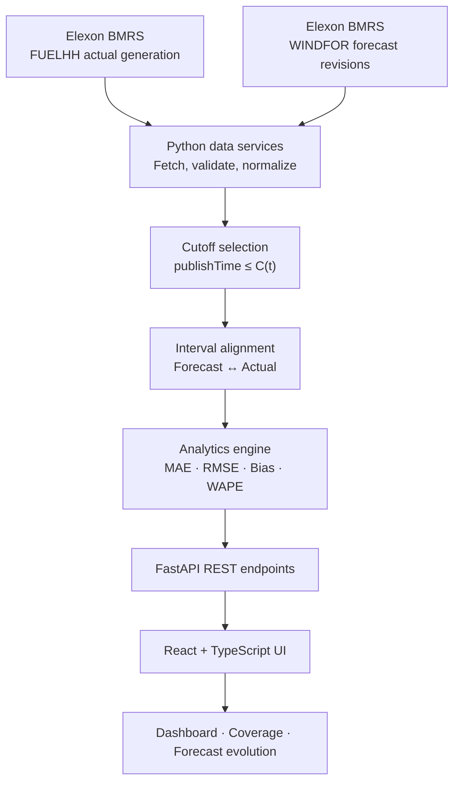

<div align="center">

# 🌬️ WindSight
### Day-Ahead Wind Forecast Intelligence

**See the forecast the desk could actually have known — not the one hindsight prefers.**

A transparent evaluation platform for comparing UK national wind-generation forecasts with realized Elexon settlement actuals, while controlling for look-ahead bias.

<p>
  <a href="#-what-windsight-does"></a>
  <a href="#-evaluation-scope"></a>
  <a href="#-methodology"></a>
</p>

<p>
  
  
  
  
  
  
  
  
</p>

[Overview](#-what-windsight-does) · [Architecture](#-architecture) · [Methodology](#-methodology) · [Quickstart](#-quickstart) · [API](#-api-reference) · [Testing](#-testing) · [AI Disclosure](#-ai-use-disclosure)

</div>

---

## 🎯 What WindSight Does

WindSight reconstructs the forecast information available at a defined decision cutoff and evaluates it against realized wind generation. This matters because forecast datasets can contain later revisions that were not available when a day-ahead decision would have been made.

### Why it matters

> **A fair forecast evaluation must use information available at decision time.** A later, more accurate forecast must not be allowed to rewrite the historical decision context.

| Capability | What it provides |
|---|---|
| 🕒 **Cutoff-aware forecast selection** | Selects the latest eligible forecast published at or before the configured cutoff. |
| 📏 **Forecast error metrics** | Reports MAE, RMSE, signed bias, and WAPE over valid matched intervals. |
| 🧩 **Coverage transparency** | Tracks matched intervals and missing forecast/actual records instead of silently fabricating values. |
| 🔄 **Forecast evolution** | Exposes forecast revisions around the decision cutoff for a selected delivery interval. |
| 📆 **Historical analytics** | Supports daily dashboard analysis and aggregated January 2026 date ranges. |

## 🗓️ Evaluation Scope

| Dimension | Scope |
|---|---|
| Evaluation window | 1–31 January 2026 |
| Time basis | UTC in the documented API contract; verify upstream timestamp semantics in deployment |
| Resolution | 30-minute settlement intervals; expected 48 intervals per ordinary day |
| Geography | National UK wind generation |
| Actuals | Elexon `FUELHH`, filtered to `fuelType = WIND` |
| Forecasts | Elexon `WINDFOR`, including `startTime` and `publishTime` |
| Intended use | Forecast-performance analysis for a day-ahead procurement desk |

### Explicitly out of scope

- Consumer or system-demand forecasting
- Electricity price prediction or imbalance-price modelling
- Trading recommendations, procurement optimization, or P&L claims
- Cross-fuel portfolio optimization
- Model retraining or claims that historical accuracy guarantees future performance

---

## 🧱 Architecture



### 🧰 Technology Stack

| Layer | Technologies |
|---|---|
| UI |    Recharts · Tailwind CSS |
| API |   Pydantic |
| Data & analytics |  HTTPX |
| Quality |  |
| Containers |  Docker Compose |
| Data provider | Elexon BMRS datasets |

### Request flow

1. The frontend requests a delivery date or date range from the API.
2. The backend fetches actual generation and wind-forecast records from Elexon.
3. Forecast records are filtered by the configured publication cutoff.
4. Eligible forecasts are aligned with actual generation by delivery interval.
5. The analytics service calculates metrics and coverage counts.
6. The API returns structured data for the frontend to display.

---

## 🧪 Methodology

### 1. Preventing look-ahead bias

For delivery interval \(t\), let \(C(t)\) denote the configured decision cutoff. A forecast is eligible only when:

\[
\text{publishTime} \leq C(t)
\]

When several forecasts qualify for the same delivery interval, WindSight selects the forecast with the **latest eligible `publishTime`**. Forecasts published after the cutoff may be shown in forecast-evolution analysis, but must not be selected as the decision-time forecast.

<details>
<summary><strong>🔎 Cutoff assumption — read before interpreting results</strong></summary>

The current pilot uses `day_ahead_1700` as its default cutoff strategy, alongside `gate_closure` and `fixed_4h` options in the API. Treat the 17:00 cutoff as a **documented pilot assumption**, not an official market rule, unless it has been independently validated against the applicable market specification. Always document the time zone and the precise cutoff calculation.

</details>

### 2. Metrics

For \(n\) valid matched intervals, let \(F_i\) be the selected forecast and \(A_i\) the observed actual generation. Define signed error as \(e_i = F_i - A_i\).

<details>
<summary><strong>📐 View metric definitions</strong></summary>

**Mean Absolute Error (MAE)** — average magnitude of the error:

\[
\mathrm{MAE} = \frac{1}{n}\sum_{i=1}^{n}|F_i-A_i|
\]

**Root Mean Squared Error (RMSE)** — penalizes larger errors more strongly:

\[
\mathrm{RMSE} = \sqrt{\frac{1}{n}\sum_{i=1}^{n}(F_i-A_i)^2}
\]

**Signed Bias** — shows systematic over- or under-forecasting:

\[
\mathrm{Bias} = \frac{1}{n}\sum_{i=1}^{n}(F_i-A_i)
\]

Positive bias means forecast generation was higher than actual generation on average; negative bias means it was lower.

**Weighted Absolute Percentage Error (WAPE)**:

\[
\mathrm{WAPE} = \frac{\sum_{i=1}^{n}|F_i-A_i|}{\sum_{i=1}^{n}|A_i|}\times100\%
\]

WAPE should be `null`/undefined when the denominator is zero. The API reports metrics in MW where applicable and WAPE as a percentage.

</details>

### 3. Coverage is part of the result

Metrics are only as representative as their matched data. WindSight tracks expected intervals, matched intervals, missing forecasts, and missing actuals. Missing values should not be silently replaced with zero or future forecast revisions.

---

## 🚀 Quickstart

### Prerequisites

- Git
- Python 3.11+
- Node.js 18+
- Docker Desktop with Docker Compose (for containerized startup)

<details>
<summary><strong>🐳 Option A — Run with Docker Compose (recommended)</strong></summary>

1. Install and launch Docker Desktop.
2. Open a terminal at the repository root (the folder containing `docker-compose.yml`).
3. Create a local environment file if the project configuration requires it:

   **PowerShell**
   ```powershell
   Copy-Item .env.example .env
   ```

   **macOS/Linux**
   ```bash
   cp .env.example .env
   ```

4. Review `.env` and use real credentials only if the application requires them. Never commit `.env`.

5. Build and start the services:

   ```bash
   docker compose up --build
   ```

6. When finished, stop the stack with `Ctrl+C`, then run:

   ```bash
   docker compose down
   ```

Expected local URLs based on the project plan (confirm against `docker-compose.yml`):

- Frontend: `http://localhost:5173`
- API docs: `http://localhost:8000/docs`
- Health check: `http://localhost:8000/api/health`

</details>

<details>
<summary><strong>🧑‍💻 Option B — Run backend and frontend separately</strong></summary>

Open two terminals from the repository root.

**Backend — PowerShell**

```powershell
cd backend
python -m venv .venv
.\.venv\Scripts\Activate.ps1
python -m pip install -r requirements.txt
uvicorn app.main:app --reload --port 8000
```

**Frontend — another terminal**

```powershell
cd frontend
npm install
npm run dev
```

If PowerShell blocks virtual-environment activation, you can invoke the environment's Python executable directly or adjust the execution policy for the current user according to your organization's policy. Confirm the frontend's API base URL in `frontend/src/services/api.ts` and the actual development port in `frontend/vite.config.ts`.

</details>

---

## 🔌 API Reference

Interactive OpenAPI documentation is available at `http://localhost:8000/docs` when the backend is running locally.

| Method | Endpoint | Purpose |
|---|---|---|
| `GET` | `/` | API welcome message, version, and pilot scope |
| `GET` | `/api/health` | Service health, UTC timestamp, and version |
| `GET` | `/api/dashboard?date=2026-01-15` | Interval-level forecast/actual comparison, metrics, and coverage |
| `GET` | `/api/analytics?from=2026-01-01&to=2026-01-07` | Aggregate metrics and daily breakdown for a date range |
| `GET` | `/api/forecast-evolution?date=2026-01-15` | Forecast publication revisions and selected pre-cutoff forecast |

### Common query parameters

| Parameter | Applies to | Description |
|---|---|---|
| `date` | `dashboard`, `forecast-evolution` | Required delivery date in January 2026 |
| `from`, `to` | `analytics` | Required date range; `from` must be on or before `to` |
| `cutoff_rule` | Dashboard, analytics, forecast evolution | Cutoff strategy; defaults to `day_ahead_1700` |
| `hourly_expansion` | Dashboard, analytics | Optional Boolean; defaults to `false` |
| `interval_start` | Forecast evolution | Optional interval start; defaults to 12:00 UTC on the selected date |

### Response highlights

- **Dashboard:** delivery date, cutoff rule, interval list, metrics, and hourly-expansion flag.
- **Interval:** start/end, settlement period, forecast MW, publication time, actual MW, signed error, and matching status.
- **Metrics:** MAE, RMSE, bias, WAPE, expected intervals, matched intervals, missing forecasts, and missing actuals.
- **Analytics:** aggregate metrics plus daily metrics.
- **Forecast evolution:** cutoff timestamp, selected forecast, and ordered publication revisions.

> Dates outside the January 2026 pilot window and reversed analytics date ranges return HTTP 400. Upstream data-fetch failures return HTTP 502. See `/docs` for the live schemas and full response models.

---

## ✅ Testing

Run the backend tests from the repository root, using the test setup in this project:

```powershell
python -m pytest backend/tests/ -v
```

The test suite includes analytics, API, Elexon, fixture, and end-to-end integration test modules. Run the tests before submission and report the actual result—do not claim that checks passed unless they were executed successfully.

Recommended final checks:

- [ ] Metric formulas and edge cases, including a zero WAPE denominator
- [ ] Inclusive cutoff comparison and latest eligible forecast selection
- [ ] No post-cutoff forecast used as the selected decision forecast
- [ ] Missing forecast/actual coverage reported correctly
- [ ] January 2026 date validation
- [ ] Frontend-to-backend integration
- [ ] Docker Compose startup and health endpoint

---

## 🌍 Deployment

The intended deployment setup is:

- **Frontend:** Vercel or an equivalent static/frontend host
- **Backend:** Python-compatible host supporting the backend container

| Resource | Link |
|---|---|
| Live frontend | `ADD_DEPLOYED_FRONTEND_URL` |
| Backend API | `ADD_DEPLOYED_BACKEND_URL` |
| API documentation | `ADD_DEPLOYED_BACKEND_URL/docs` |

Replace the placeholders only after deployment. Then verify the links in a private/incognito browser window. Configure production API URLs and CORS origins through the hosting provider's environment settings.

---

## 🤖 AI-Use Disclosure

This project README should accurately reflect the assistance actually used during development.

**Tools:** Google Antigravity / Gemini (as used by the project author). 

**Assistance areas:** If applicable, disclose assistance with application scaffolding, debugging, documentation structure, or test-case drafting. 

**Human verification:** The project author remains responsible for reviewing the implementation, data assumptions, metric calculations, cutoff logic, and test results. State that analytical calculations and cutoff logic were verified with deterministic unit tests **only after those tests have been run and passed**. If verification is incomplete, describe the outstanding work accurately.

---

## 🔐 Repository Hygiene

Before publishing the repository:

- [ ] Keep `.env` and other local secret files out of Git.
- [ ] Ensure `.env.example` contains placeholders only.
- [ ] Inspect tracked files **and Git history** for credentials; deleting a secret in a later commit does not remove it from earlier commits.
- [ ] Remove private data and unintended generated artifacts.
- [ ] Replace all deployment placeholders.
- [ ] Confirm API docs and commands match the implementation.
- [ ] Run tests and report the actual results.
- [ ] Verify the public repository and deployed app in a private/incognito window.

---

## ⚠️ Limitations

WindSight is a historical forecast-evaluation pilot, not a complete procurement decision system. Results depend on source-data completeness, timestamp semantics, interval alignment, and the configured cutoff. Forecast accuracy alone does not determine demand, electricity prices, network constraints, balancing actions, procurement requirements, or financial outcomes.

---

<div align="center">

**Built for transparent forecast evaluation.**  
*Use the information available then—not the information revealed later.*

</div>
