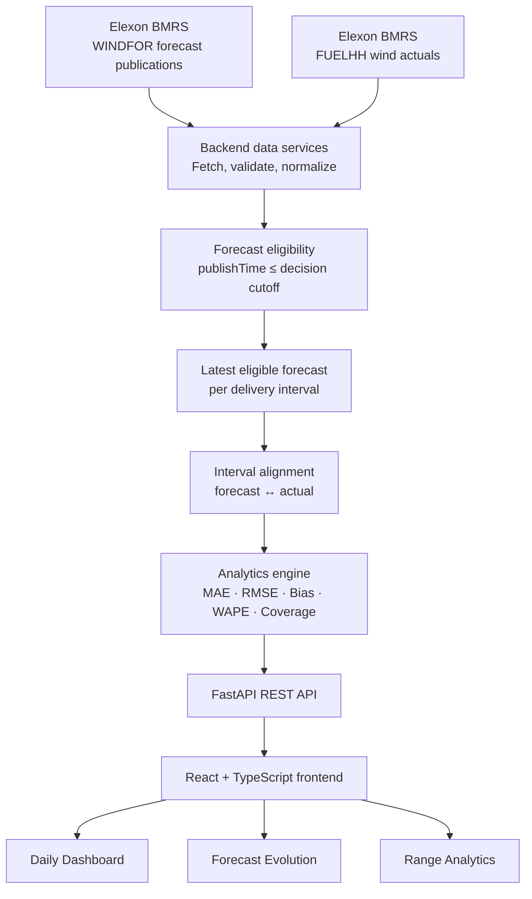
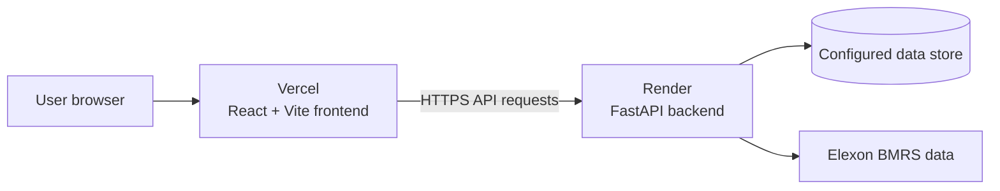
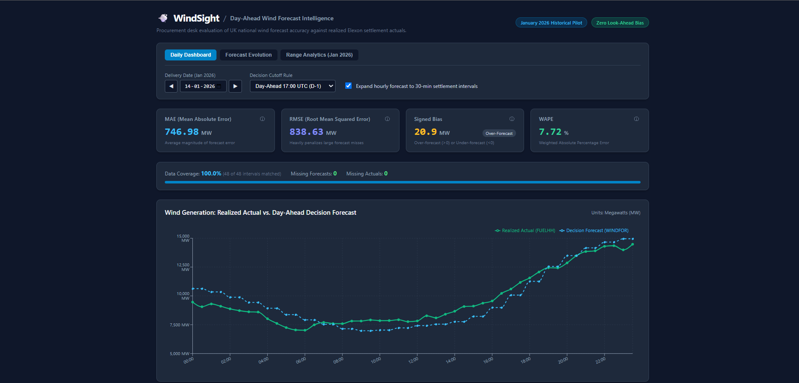
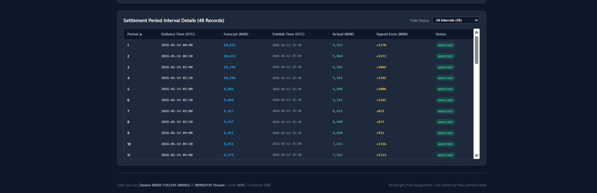
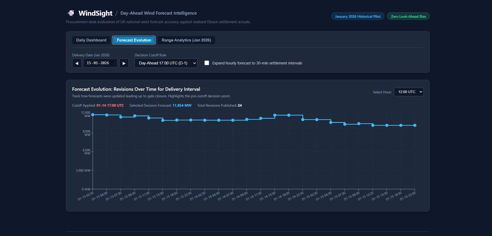
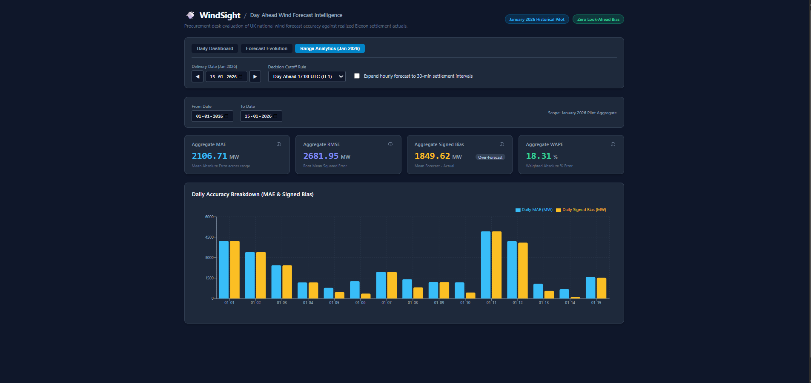

# 🌬️ WindSight

### Day-Ahead Wind Forecast Intelligence

**Evaluate the forecast that was available at decision time — not the
one hindsight prefers.**

A historical evaluation platform for UK national wind-generation
forecasts, comparing Elexon forecast publications with realized
settlement data while making forecast revisions, coverage, and
look-ahead-bias controls visible.

[](https://gridbricks-five.vercel.app/)
[](https://windsight-api-rd5o.onrender.com/docs)
[](#evaluation-scope)


**Live application:** https://gridbricks-five.vercel.app/\
**Backend API:** https://windsight-api-rd5o.onrender.com\
**Interactive API documentation:**
https://windsight-api-rd5o.onrender.com/docs

------------------------------------------------------------------------

## Table of Contents

- [Project Overview](#project-overview)
- [Problem Statement](#problem-statement)
- [Key Features](#key-features)
- [Evaluation Scope](#evaluation-scope)
- [Data Sources](#data-sources)
- [System Architecture](#system-architecture)
- [Application Walkthrough](#application-walkthrough)
- [Forecast Selection and Look-Ahead
    Bias](#forecast-selection-and-look-ahead-bias)
- [Hourly-to-Half-Hourly Expansion](#hourly-to-half-hourly-expansion)
- [Evaluation Metrics](#evaluation-metrics)
- [API Reference](#api-reference)
- [Technology Stack](#technology-stack)
- [Repository Structure](#repository-structure)
- [Run Locally](#run-locally)
- [Docker](#docker)
- [Deployment](#deployment)
- [Configuration and Environment
    Variables](#configuration-and-environment-variables)
- [Validation and Testing](#validation-and-testing)
- [Known Limitations](#known-limitations)
- [Security and Data Handling](#security-and-data-handling)
- [AI Assistance Disclosure](#ai-assistance-disclosure)
- [Future Improvements](#future-improvements)
- [Author](#author)

------------------------------------------------------------------------

## Project Overview

WindSight is a day-ahead wind forecast intelligence dashboard built
around a historical January 2026 pilot. It compares forecast wind
generation published by Elexon with realized national wind generation
and presents the results through an interactive web application.

The central design principle is **decision-time evaluation**: when
judging a forecast, use only the forecast information that would have
been available at the configured decision cutoff. Later revisions must
not silently replace the forecast that was available at that earlier
point in time.

WindSight provides three analytical views:

1. **Daily Dashboard** — compares selected day-ahead forecasts with
    realized generation at settlement-interval level and reports
    accuracy metrics and data coverage.
2.  **Forecast Evolution** — displays how the forecast for a selected
    delivery interval changed across publication revisions, including
    the cutoff and selected decision forecast.
3.  **Range Analytics** — aggregates forecast accuracy over a selected
    date range and presents daily metric breakdowns.

The application is an analytical pilot and demonstration platform. It is
not an automated trading, bidding, or procurement system.

## Problem Statement

Historical forecast datasets can contain multiple publications for the
same delivery interval. Some publications may have been released after
the decision point being evaluated.

If an evaluation simply selects the latest forecast in the historical
dataset, it can use information that was not available to a
decision-maker at the time. This is **look-ahead bias** and can distort
historical performance.

WindSight addresses this by retaining forecast publication timestamps,
applying a configurable decision cutoff, selecting the latest eligible
forecast, aligning it with realized generation, reporting missing data,
and exposing forecast revisions for inspection.

## Key Features

  -----------------------------------------------------------------------
  Feature                             Description
  ----------------------------------- -----------------------------------
  Cutoff-aware forecast selection     Selects the latest eligible
                                      forecast published at or before the
                                      configured cutoff.

  Daily forecast-versus-actual        Visualizes selected forecast
  dashboard                           generation alongside realized
                                      generation.

  Forecast revision history           Shows forecast publications over
                                      time for a selected delivery
                                      interval.

  Range-level analytics               Aggregates MAE, RMSE, signed bias,
                                      and WAPE across a date range.

  Settlement interval table           Shows delivery time, forecast,
                                      publication time, actual, signed
                                      error, and match status.

  Coverage reporting                  Reports expected, matched,
                                      missing-forecast, and
                                      missing-actual interval counts.

  Hourly forecast expansion           Optionally maps an hourly forecast
                                      value onto both half-hour
                                      settlement intervals in that hour.

  Configurable cutoff strategy        Exposes cutoff selection through
                                      the API and dashboard.

  Interactive API documentation       Provides OpenAPI/Swagger
                                      documentation through FastAPI.
  -----------------------------------------------------------------------

## Evaluation Scope

  -----------------------------------------------------------------------
  Dimension                           Pilot scope
  ----------------------------------- -----------------------------------
  Evaluation period                   1 January 2026 -- 31 January 2026

  Geography                           UK national wind generation

  Forecast source                     Elexon BMRS `WINDFOR`

  Actual generation source            Elexon BMRS `FUELHH`, filtered to
                                      wind (`fuelType = WIND`)

  Settlement resolution               Half-hourly intervals

  Expected intervals                  48 per ordinary 24-hour day

  Dashboard time labels               UTC, as presented by the
                                      application

  Default cutoff strategy             `day_ahead_1700`

  Intended audience                   Analytical/procurement-desk
                                      evaluation context
  -----------------------------------------------------------------------

The 17:00 day-ahead cutoff is a **pilot configuration/analytical
assumption**. It should not be interpreted as a verified official market
deadline or market rule unless separately checked against applicable
market documentation. The selected cutoff, time zone, and timestamp
semantics should always be considered when interpreting results.

### Out of scope

- Electricity price or imbalance-price forecasting
- Consumer or system-demand forecasting
- Trading signals or automated bidding
- Procurement optimization
- Financial return, savings, or P&L calculations
- Network constraint or balancing-action forecasts
- Guarantees that historical forecast accuracy will continue in future
    periods

## Data Sources

WindSight uses Elexon BMRS data streams for the historical pilot.

### WINDFOR — wind generation forecasts

The `WINDFOR` stream provides wind-generation forecast publications. The
publication timestamp is important because the same delivery interval
may have multiple forecast revisions.

WindSight uses forecast delivery information and publication time to
determine which forecast revision was available by the configured
cutoff.

### FUELHH — realized generation

The `FUELHH` stream provides half-hourly generation data by fuel type.
For this pilot, actual generation is filtered to wind records
(`fuelType = WIND`) and used as the realized value against which the
selected forecast is evaluated.

### Data handling principles

- Forecast and actual values are compared after their delivery
    intervals have been aligned.
- Publication time is retained for forecast eligibility and revision
    analysis.
- Missing forecast and actual values are represented as missing
    coverage, not silently treated as zero.
- Data resolution differences are made visible in the dashboard.
- Results depend on the completeness and timestamp quality of upstream
    data.

**Data provider:** [Elexon](https://www.elexon.co.uk/)

------------------------------------------------------------------------

## System Architecture



### Deployed topology



The frontend is hosted on Vercel and the FastAPI backend is hosted on
Render. The frontend calls the backend over HTTPS. The backend CORS
configuration must include the deployed Vercel origin.

### Request lifecycle

1. A user selects a delivery date, date range, cutoff rule, or
    forecast-evolution interval.
2.  The frontend sends the corresponding request to FastAPI.
3.  The backend obtains the required forecast and actual records from
    its configured data source.
4.  Forecast publications are evaluated against the selected cutoff.
5.  Eligible forecast values are aligned with realized generation by
    delivery interval.
6.  The analytics layer calculates error metrics and coverage
    information.
7.  The API returns structured results.
8.  The frontend renders KPI cards, charts, and interval-level details.

- [Application Walkthrough](#application-walkthrough)
## Application Walkthrough

The screenshots below show the application's main views. The image files are included in the repository under `screenshots/`.

### 1. Daily Dashboard

The dashboard compares realized wind generation with the day-ahead decision forecast and summarizes forecast-error metrics and settlement-period coverage.



The interval table provides settlement-period detail, including delivery time, selected forecast, publication time, actual generation, signed error, and match status.



### 2. Forecast Evolution

This view shows how forecast revisions changed over time for a selected delivery interval and identifies the forecast available at the configured decision cutoff.



### 3. Range Analytics

Range Analytics aggregates forecast performance over a selected date range, showing aggregate error metrics and a daily accuracy breakdown.



## Forecast Selection and Look-Ahead Bias

This is the core analytical safeguard in WindSight.

For a delivery interval \(t\), let \(C(t)\) represent the configured
decision cutoff timestamp. A forecast publication is eligible only if:

$$
publishTime(f) \leq C(t)
$$

If multiple forecast publications exist for the same delivery interval,
WindSight selects the **latest eligible publication**:

$$
f_t^* = \operatorname*{arg\,max}_{f \in \mathcal{F}_t,\; publishTime(f) \leq C(t)} publishTime(f)
$$

Where:

- (`\mathcal{F}\_t) is the set of forecast publications for
    delivery interval (t);
- `publishTime(f)` is the publication timestamp of forecast (f);
- (C(t)) is the configured cutoff for interval (t); and
- (F_t\^\*) is the forecast selected for decision-time evaluation.

A historical dataset may contain revisions published after the decision
cutoff. Those revisions may be useful in Forecast Evolution, but they
must not replace the decision-time forecast.

### Cutoff strategies

The default pilot strategy is `day_ahead_1700`. The earlier project
specification also describes `gate_closure` and `fixed_4h` options. The
exact timestamp calculation for each rule is defined by the current
backend implementation. The 17:00 rule is a pilot assumption, not a
claim about an official market deadline.

## Hourly-to-Half-Hourly Expansion

The WINDFOR forecast data used in this pilot is hourly, while settlement
actuals are represented at half-hourly resolution.

Without expansion, strict interval matching can pair each hourly
forecast with the corresponding on-the-hour settlement interval only. In
the deployed dashboard this can appear as 48 expected half-hourly
intervals, 24 matched forecast intervals, 24 missing forecast intervals,
and 0 missing actual intervals.

WindSight provides an optional **Expand hourly forecast to 30-min
settlement intervals** setting. When enabled, the hourly forecast value
is applied to both half-hour settlement intervals within the same
delivery hour.

  Settlement interval     Expanded forecast
  --------------------- -------------------
  00:00                           15,087 MW
  00:30                           15,087 MW
  01:00                           13,617 MW
  01:30                           13,617 MW

This is a resolution-alignment assumption. It does **not** create a new
independently observed half-hourly forecast or add new forecast
information. It increases the number of matched comparison intervals, so
metrics may change.

When quoting results, state whether hourly expansion was enabled.

## Evaluation Metrics

For (n) valid matched intervals, define:

- (F_i): selected forecast generation for interval (i), in MW;
- (A_i): realized actual generation for interval (i), in MW;
- (e_i = F_i - A_i): signed forecast error.

### Mean Absolute Error (MAE)

\[ MAE = `\frac{1}{n}`\sum\_{i=1}\^{n}\|F_i-A_i\| \]

Lower MAE indicates smaller average absolute error.

### Root Mean Squared Error (RMSE)

\[ RMSE = `\sqrt{\frac{1}{n}\sum_{i=1}^{n}(F_i-A_i)^2} \]

RMSE penalizes larger errors more strongly.

### Signed Bias

\[ Bias = `\frac{1}{n}`\sum\_{i=1}\^{n}(F_i-A_i) \]

- Positive bias: forecasts are higher than actual generation on
    average (over-forecast).
- Negative bias: forecasts are lower than actual generation on average
    (under-forecast).
- Bias near zero does not necessarily mean forecasts are accurate;
    positive and negative errors can cancel.

### Weighted Absolute Percentage Error (WAPE)

\[ WAPE = `\frac{\sum_{i=1}^{n}|F_i-A_i|}
{`\sum\_{i=1}\^{n}\|A_i\|} `\times 100% \]

WAPE expresses total absolute error relative to total absolute actual
generation. If the denominator is zero, the metric should be
undefined/null rather than divided by zero.

### Coverage metrics

  -----------------------------------------------------------------------
  Coverage field                      Meaning
  ----------------------------------- -----------------------------------
  Expected intervals                  Number of settlement intervals
                                      expected for the selected
                                      date/range

  Matched intervals                   Intervals with both a usable
                                      forecast and an actual value

  Missing forecasts                   Intervals without a usable forecast

  Missing actuals                     Intervals without a usable actual
                                      value

  Coverage percentage                 Matched intervals divided by
                                      expected intervals, multiplied by
                                      100
  -----------------------------------------------------------------------

A 100% coverage figure after hourly expansion means every half-hour
settlement interval has a forecast value under the expansion rule. It
does not mean that 48 independent forecast publications were available.

------------------------------------------------------------------------

## API Reference

The backend exposes an OpenAPI specification and interactive Swagger UI.

- **Production API root:** https://windsight-api-rd5o.onrender.com/
- **Swagger UI:** https://windsight-api-rd5o.onrender.com/docs
- **OpenAPI JSON:**
    https://windsight-api-rd5o.onrender.com/openapi.json
- **Health endpoint:**
    https://windsight-api-rd5o.onrender.com/api/health

### Endpoints

  ----------------------------------------------------------------------------
  Method                  Endpoint                    Purpose
  ----------------------- --------------------------- ------------------------
  `GET`                   `/`                         Root message,
                                                      application version, and
                                                      pilot scope

  `GET`                   `/api/health`               Backend health and
                                                      configured data-source
                                                      status

  `GET`                   `/api/dashboard`            Daily
                                                      forecast-versus-actual
                                                      data, metrics, and
                                                      coverage

  `GET`                   `/api/analytics`            Aggregate metrics and
                                                      daily breakdown for a
                                                      date range

  `GET`                   `/api/forecast-evolution`   Forecast publication
                                                      revisions for a delivery
                                                      date/interval
  ----------------------------------------------------------------------------

### Example requests

**Health check**

``` http
GET https://windsight-api-rd5o.onrender.com/api/health
```

**Daily dashboard**

``` http
GET https://windsight-api-rd5o.onrender.com/api/dashboard?date=2026-01-15&cutoff_rule=day_ahead_1700&hourly_expansion=false
```

**Daily dashboard with hourly expansion**

``` http
GET https://windsight-api-rd5o.onrender.com/api/dashboard?date=2026-01-15&cutoff_rule=day_ahead_1700&hourly_expansion=true
```

**Range analytics**

``` http
GET https://windsight-api-rd5o.onrender.com/api/analytics?from=2026-01-01&to=2026-01-15
```

**Forecast evolution**

``` http
GET https://windsight-api-rd5o.onrender.com/api/forecast-evolution?date=2026-01-15
```

The live Swagger page is the source of truth for required parameters,
optional parameters, defaults, and response schemas. Open `/docs` for
the exact current contract.

## Technology Stack

  --------------------------------------------------------------------------
  Layer                      Technology              Responsibility
  -------------------------- ----------------------- -----------------------
  Frontend framework         React                   Interactive user
                                                     interface

  Frontend language          TypeScript              Typed frontend code

  Frontend tooling           Vite                    Development server and
                                                     production build

  Data visualization         Recharts                Forecast, actual,
                                                     revision, and metric
                                                     charts

  Backend language           Python 3.11             Backend application and
                                                     analytics

  API framework              FastAPI                 REST API and OpenAPI
                                                     documentation

  Data processing            Pandas                  Tabular data
                                                     transformation and
                                                     interval analysis

  HTTP client                HTTPX                   HTTP communication with
                                                     data services

  Validation/configuration   Pydantic / application  Request and
                             settings                configuration handling

  Testing                    Pytest                  Backend tests

  Containerization           Docker / Docker Compose Local container-based
                                                     execution

  Frontend hosting           Vercel                  Production frontend
                                                     deployment

  Backend hosting            Render                  Production API
                                                     deployment

  Data provider              Elexon BMRS             Wind forecasts and
                                                     realized generation
                                                     data
  --------------------------------------------------------------------------

## Repository Structure

This is a high-level logical layout. Check the repository for exact
filenames and any additional modules.

``` text
gridbricks/
│
├── backend/
│   ├── app/
│   │   ├── main.py              # FastAPI application and middleware
│   │   ├── api/
│   │   │   └── routes.py        # API route registration
│   │   ├── ...                  # Data, analytics, models and configuration
│   ├── tests/                   # Backend test modules and fixtures
│   ├── requirements.txt
│   └── Dockerfile
│
├── frontend/
│   ├── src/
│   │   └── ...                  # React components, pages and API client
│   ├── package.json
│   ├── vite.config.ts
│   └── Dockerfile
│
├── docker-compose.yml
├── .env.example
├── .gitignore
└── README.md
```

## Run Locally

### Prerequisites

- Git
- Python 3.11
- Node.js and npm
- Optional: Docker Desktop with Docker Compose

Clone the repository:

``` bash
git clone https://github.com/Adityaez/gridbricks.git
cd gridbricks
```

### Backend setup — Windows PowerShell

``` powershell
cd backend

python -m venv .venv
.\.venv\Scripts\Activate.ps1

python -m pip install --upgrade pip
pip install -r requirements.txt

uvicorn app.main:app --reload --host 127.0.0.1 --port 8000
```

Local backend URLs:

- API root: http://127.0.0.1:8000/
- Swagger UI: http://127.0.0.1:8000/docs
- Health check: http://127.0.0.1:8000/api/health

### Backend setup — macOS/Linux

``` bash
cd backend

python3.11 -m venv .venv
source .venv/bin/activate

python -m pip install --upgrade pip
pip install -r requirements.txt

uvicorn app.main:app --reload --host 127.0.0.1 --port 8000
```

### Frontend setup

Open a second terminal from the repository root:

``` bash
cd frontend
npm install
```

The deployed Vite application uses this API base URL:

``` env
VITE_API_BASE_URL=https://windsight-api-rd5o.onrender.com
```

For local development, use the local backend URL if the frontend
configuration supports it:

``` env
VITE_API_BASE_URL=http://127.0.0.1:8000
```

Place frontend environment variables in the appropriate Vite environment
file (for example, `frontend/.env.local`) and ensure the API client
reads the same variable name. Vite exposes only variables prefixed with
`VITE_` to browser code.

Start the frontend:

``` bash
npm run dev
```

Open the local Vite URL printed in the terminal (commonly
http://localhost:5173).

### Production frontend build

From `frontend/`:

``` bash
npm run build
```

Vite writes the production bundle to `frontend/dist` by default. The
Vercel deployment uses `frontend` as its root directory, `npm run build`
as the build command, and `dist` as the output directory.

## Docker

The repository includes Docker-related project configuration. If Docker
Desktop is installed and the Compose file is configured for the current
project layout, run from the repository root:

``` bash
docker compose up --build
```

Stop the services with:

``` bash
docker compose down
```

The exact ports, service names, environment variables, and health checks
are defined by the current `docker-compose.yml` and Dockerfiles. Confirm
those files before relying on example local URLs.

## Deployment

WindSight is deployed as two services.

  ----------------------------------------------------------------------------------------------------
  Component               Provider                Live URL
  ----------------------- ----------------------- ----------------------------------------------------
  Frontend                Vercel                  https://gridbricks-five.vercel.app/

  Backend                 Render                  https://windsight-api-rd5o.onrender.com/

  API documentation       Render                  https://windsight-api-rd5o.onrender.com/docs

  Health check            Render                  https://windsight-api-rd5o.onrender.com/api/health
  ----------------------------------------------------------------------------------------------------

### Frontend deployment — Vercel

The deployed Vercel project uses the GitHub repository and the `main`
branch.

  Setting            Value
  ------------------ -------------------------------------------
  Framework preset   Vite
  Git branch         `main`
  Root directory     `frontend`
  Build command      `npm run build`
  Output directory   `dist`
  API base URL       `https://windsight-api-rd5o.onrender.com`

Vercel environment variable:

``` env
VITE_API_BASE_URL=https://windsight-api-rd5o.onrender.com
```

### Backend deployment — Render

The backend is deployed as a Python web service from the `backend/`
directory.

  Setting          Value
  ---------------- ----------------------------------------------------
  Repository       `Adityaez/gridbricks`
  Branch           `main`
  Root directory   `backend/`
  Build command    `pip install -r requirements.txt`
  Start command    `uvicorn app.main:app --host 0.0.0.0 --port $PORT`

Render supplies the port through `$PORT`. Do not hard-code port `8000`
in the production start command.

### CORS configuration

The backend must allow the exact deployed frontend origin. The Render
environment variable used in this deployment is:

``` env
BACKEND_CORS_ORIGINS=["http://localhost:5173","http://localhost:3000","https://gridbricks-five.vercel.app"]
```

The backend settings must parse this value in the format expected by the
application. If the frontend's production domain changes, update the
allowed origin and redeploy the backend.

### Free-tier behavior

The backend currently uses a Render Free service. Free instances may
spin down after inactivity and take time to wake up when a new request
arrives. The first request after inactivity may therefore be slower than
subsequent requests. This is hosting behavior, not necessarily an
application error.

## Configuration and Environment Variables

Environment variable names and defaults are defined by the backend
settings module and frontend API client. The following are the
deployment-related variables used in this setup.

  ------------------------------------------------------------------------
  Variable                 Where                   Purpose
  ------------------------ ----------------------- -----------------------
  `BACKEND_CORS_ORIGINS`   Render backend          Allowed browser origins

  `VITE_API_BASE_URL`      Vercel frontend         Base URL used by
                                                   frontend API requests

  `PORT`                   Render runtime          Port supplied by Render
                                                   and consumed by the
                                                   start command

  `ELEXON_API_KEY`         Backend, only if        Private provider
                           required                credential if
                                                   configured data access
                                                   requires it

  `DEFAULT_CUTOFF_RULE`    Backend, if supported   Default decision cutoff
                                                   strategy
  ------------------------------------------------------------------------

Do not create variables that the application does not read. Check the
backend settings and frontend API client before adding or renaming
configuration keys.

### Secrets

- Never commit `.env`, API keys, database passwords, or private
    connection strings.
- Keep `.env.example` limited to placeholder values.
- Configure production secrets in hosting-provider environment
    settings.
- If a secret was ever committed, rotate it; deleting it in a later
    commit does not remove it from Git history.

## Validation and Testing

### Live smoke tests

The following checks were performed during deployment validation:

- Render health endpoint returned HTTP `200 OK`.
- FastAPI Swagger UI loaded from the deployed backend.
- Vercel frontend loaded and successfully displayed data from the
    Render API.
- Daily Dashboard displayed forecast/actual metrics and settlement
    interval details.
- January 28, 2026 dashboard data loaded.
- Hourly expansion changed coverage from 24/48 (50%) to 48/48 (100%)
    for the tested January 28 view.
- Forecast Evolution displayed revision history for January 14, 2026.
- Range Analytics displayed aggregate metrics and daily accuracy
    breakdown for January 1--15, 2026.

These are deployment smoke-test observations, not a claim that every
possible input, edge case, or automated test has passed.

### Backend test command

From the repository root:

``` powershell
python -m pytest backend/tests/ -v
```

Run the tests in the project's configured Python environment. Record the
actual result before claiming the test suite passes.

### Recommended analytical test cases

- Latest eligible forecast is selected when multiple publications
    exist.
- A forecast published after the cutoff is not selected as the
    decision-time forecast.
- A publication exactly at the cutoff is handled according to the
    inclusive comparison rule.
- Forecast and actual intervals align correctly.
- Missing forecasts and missing actuals are counted independently.
- Hourly expansion maps the hourly value to the intended two half-hour
    intervals.
- MAE, RMSE, signed bias, and WAPE match hand-calculated examples.
- WAPE handles a zero actual-value denominator safely.
- Invalid dates and reversed date ranges are rejected.
- Forecast evolution orders revisions by publication timestamp.
- API errors are returned with appropriate status codes.
- Frontend requests use the configured production API base URL.

## Known Limitations

1. **Historical pilot:** The evaluation window is January 2026. It
    should not be represented as a live operational forecasting service.
2.  **Cutoff assumption:** The 17:00 day-ahead cutoff is a pilot
    assumption unless independently validated against the relevant
    market rule.
3.  **Hourly forecast resolution:** WINDFOR hourly values and
    half-hourly settlement actuals have different resolutions. Hourly
    expansion is an explicit analytical assumption.
4.  **Coverage affects interpretation:** Metrics calculated on a subset
    of intervals may not represent the entire day or range.
5.  **Source-data dependency:** Missing, delayed, revised, or malformed
    upstream records can affect results.
6.  **Timestamp semantics:** Correct evaluation depends on consistent
    interpretation of delivery times, publication times, and time zones.
7.  **Not a trading system:** WindSight does not calculate electricity
    prices, optimize procurement, or produce trading recommendations.
8.  **Free hosting behavior:** Render Free may spin down after
    inactivity, affecting initial response latency.

## Security and Data Handling

- Keep provider credentials and database connection strings in
    environment variables.
- Do not expose backend secrets through frontend `VITE_` variables;
    Vite variables are bundled into browser code.
- Restrict CORS to known frontend origins rather than using
    unrestricted wildcard origins in production.
- Avoid committing real `.env` files or private data.
- Review Git history if credentials have ever been committed.
- Use HTTPS for deployed frontend and backend communication.

## AI Assistance Disclosure

AI-assisted tools were used during parts of the project workflow for
development support, debugging, deployment troubleshooting, and
documentation preparation. The project author is responsible for
reviewing and validating the final implementation, data assumptions,
analytical methodology, configuration, and results.

Update this disclosure to name only the tools actually used and describe
their actual contribution. Do not claim that AI-generated code,
analytical calculations, or test cases were independently verified
unless that verification was performed. The deployed smoke tests listed
above are the checks observed during deployment; they are not a
substitute for a complete automated test report.

## Future Improvements

- Add downloadable CSV exports for interval-level and range-level
    results.
- Add more explicit source-data freshness and ingestion status
    indicators.
- Add automated tests for cutoff boundaries, interval alignment, and
    metric edge cases.
- Add a reproducible historical data-ingestion command and documented
    database schema.
- Add richer filters for forecast publication and delivery intervals.
- Add responsive layouts and accessibility checks for charts and
    tables.
- Add monitoring for API availability and upstream data-fetch
    failures.
- Expand the evaluation period only after data quality and timestamp
    handling are validated.

## Author

**Aditya Sharma**\
B.Tech — Computer Science and Engineering

- GitHub: https://github.com/Adityaez
- Repository: https://github.com/Adityaez/gridbricks
- Live project: https://gridbricks-five.vercel.app/

------------------------------------------------------------------------

**
---

**WindSight — Transparent, cutoff-aware wind forecast evaluation.****

*Evaluate the information available then, not the information revealed
later.*
:::
